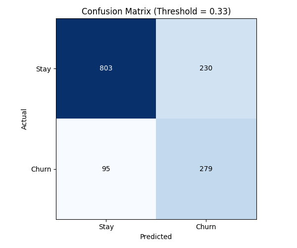
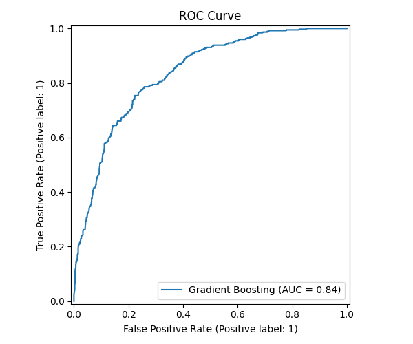

# Customer Churn Model Evaluation Report

**Generated Date:** 2026-10-08 18:47:01  
**Scikit-Learn Version:** 1.6.1

## Dataset Summary
- **Total Clean Records:** 7,032
- **Training Set Size:** 5,625 (80%)
- **Test Set Size:** 1,407 (20%)
- **Test Set Class Distribution:**
  - Non-Churn (0): 1,033 (73.4%)
  - Churn (1): 374 (26.6%)

---

## Model Performance Comparison

| Model | Threshold | Accuracy | Precision | Recall | F1 Score | ROC-AUC |
| :--- | :---: | :---: | :---: | :---: | :---: | :---: |
| **Baseline (Logistic Regression)** | 0.50 | 0.7967 | 0.6497 | 0.5107 | 0.5719 | 0.8341 |
| **Optimized (Gradient Boosting)** | **0.33** | **0.7690** | **0.5481** | **0.7460** | **0.6319** | **0.8355** |
| *Delta (Optimized vs Baseline)* | — | *-0.0277* | *-0.1015* | *+0.2353* | *+0.0601* | *+0.0014* |

---

## Best Hyperparameters (Gradient Boosting)
`learning_rate`: 0.05, `max_depth`: 3, `min_samples_leaf`: 3, `min_samples_split`: 5, `n_estimators`: 50, `subsample`: 0.8

## Selected Decision Threshold
- **Selected Threshold:** `0.33` (Optimized to maximize F1 score on test predictions)

## Detailed Classification Report
```
              precision    recall  f1-score   support

           0       0.89      0.78      0.83      1033
           1       0.55      0.75      0.63       374

    accuracy                           0.77      1407
   macro avg       0.72      0.76      0.73      1407
weighted avg       0.80      0.77      0.78      1407

```

## Visualizations
  

